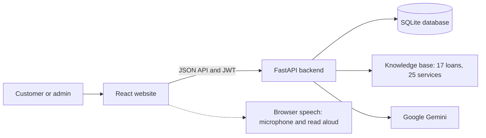
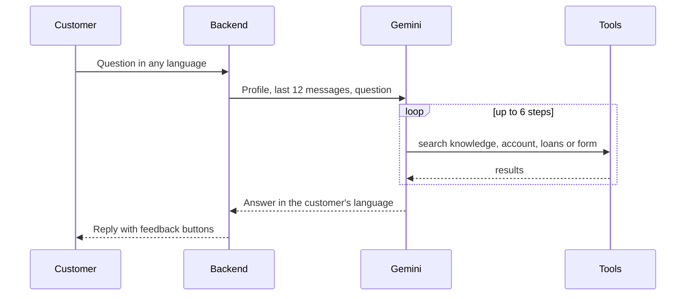
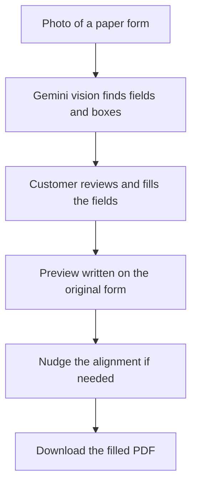

<!--
HOW TO USE THIS FILE
1. Create a folder named docs in your repo and put banner.svg inside it.
2. Optional: add screenshots to docs/screenshots/ and uncomment the Screenshots block below.
3. In the Roadmap, tick the items your site already has and delete the ones you do not plan.
4. Replace the [bracketed] placeholders (references, license).
-->

<p align="center">
  
</p>

<p align="center">
  <a href="https://stepfi.onrender.com"></a>
  
</p>

<p align="center">
  
  
  
  
  
  
  
  
</p>

<!-- Optional typing animation (free third-party service, may be slow or unavailable):
<p align="center"><a href="https://git.io/typing-svg"></a></p>
-->

> ### Having a bank account is not the same as being able to use it.
> Many people in India find banking hard to use: the language is not theirs, the forms are confusing, and charges and loan rules are never explained simply. **StepFI is an AI banking assistant that speaks your language, explains your options, and prepares your paperwork.**
>
> *Team **Beyond the Balance** · Sri Sairam Engineering College, Chennai*

---

## Banking, one step at a time

| | Step | What happens |
|:-:|---|---|
| **1** | **Choose your language** | The whole website switches, not just the chat. 23 languages: English plus 22 Indian languages. |
| **2** | **Ask in your own way** | Type, speak, or photograph a paper bank form. |
| **3** | **Understand and review** | Plain-language answers grounded in a knowledge base. Forms appear in your language for you to check. |
| **4** | **Download and go** | A filled PDF of your own form, ready to print, sign and take to the branch. |

## Why StepFI exists

| Today | With StepFI |
|---|---|
| Banking is in English or Hindi | Whole site and assistant in the customer's language |
| A different paper form at every bank, one mistake means another visit | Photo of the form in, reviewed and filled PDF out |
| Charges and loan rules are not explained | Ask "why was money deducted?" and get the reason from your own transactions |
| Hard to know which loan fits | Loans matched to your profile, with eligibility, terms, documents and steps |
| Staff cannot see what customers struggle with | Admin dashboard from real usage, with PDF reports |

## Features

| Feature | What it does |
|---|---|
| **23 languages, whole site** | About 300 interface strings plus loan, service and form-field text, translated once with Gemini and cached |
| **Conversational AI assistant** | Chats about any banking topic, remembers the recent conversation, uses simple words for low-literacy users |
| **RAG knowledge base** | 17 loan products and 25 banking services, searched before the assistant answers |
| **Account-aware answers** | Reads the signed-in customer's own account and transactions to explain charges |
| **Form from a photo** | Gemini vision finds the empty fields, you fill them, the app writes them on your original form with a preview, then exports a PDF |
| **Voice in and out** | Speak your question, hear the reply (browser speech, free) |
| **Loans by profile** | Six segments: student, adult, senior, business, agriculture, accessibility |
| **Services and guides** | How each service works, what you need, the steps, and whether it is online, at the branch or on a government portal |
| **Customer and admin dashboards** | Separate registration for each, with email verification |
| **Admin analytics and PDF reports** | Satisfaction, topics, dislike reasons, languages used, customer summary and feedback summary. Real usage only, no dummy data |

<details>
<summary><b>See who StepFI is built for</b></summary>

| Persona | What they need |
|---|---|
| Student from a village | A loan for their study level, with the documents and steps |
| Senior citizen | Simple words, voice input, replies read aloud |
| Working adult or small business owner | Charges explained, loan options by segment |
| Person with a disability | Voice, a simple interface, an accessibility loan option |
| Bank staff (admin) | Verified access, live analytics, downloadable reports |
</details>

<!--
## Screenshots
| Landing | Assistant | Form preview |
|---|---|---|
|  |  |  |
-->

## How it works



### The assistant



### Form from a photo



## The AI part

| Component | How it works |
|---|---|
| **Agent with tool calling** | Gemini decides which of five tools to call (up to 6 steps per question): `search_knowledge`, `get_account_summary`, `get_recent_transactions`, `recommend_loans`, `prepare_form` |
| **RAG** | Loans and services become searchable documents ranked with TF-IDF. The model searches in English even for a Tamil question, so one knowledge base serves every language |
| **Grounding rules** | Never invent rates, fees or eligibility. If nothing is found, say so and point to the branch |
| **Multimodal form reading** | Vision returns fields and box positions as structured JSON. The customer, not the AI, supplies the values, and plain code draws them on the form |
| **Multilingual layer** | Strings are translated in batches of 30 and cached by hash, so each string is translated once |
| **Personalisation** | The system prompt carries age, user type, area, study level and simple mode. Loan matching is rule based and the AI explains the result |
| **Feedback loop** | Thumbs and reasons feed the admin dashboard. Each answer is labelled with a topic |
| **Reliability** | Retries, backup models, and a fallback to knowledge-base answers if the AI model is unavailable |
| **Safety** | Never asks for OTP, PIN, password or CVV. Cannot move money or change bank records |

## Tech stack

| Layer | Technology |
|---|---|
| Frontend | React 18, Vite, React Router, Tailwind CSS 4, Phosphor Icons |
| Backend | Python, FastAPI, Pydantic, Uvicorn |
| Database | SQLite |
| AI | Google Gemini (chat, tool calling, vision, translation) |
| Retrieval | scikit-learn TF-IDF |
| Voice | Web Speech API |
| Documents | ReportLab, Pillow |
| Security | bcrypt, JWT, email one-time codes |
| Packaging | Docker (one container serves the site and the API) |

## Run it locally

**Backend** (Python 3.10+):
```bash
cd backend
python -m venv venv
venv\Scripts\activate          # Mac or Linux: source venv/bin/activate
pip install -r requirements.txt
copy .env.example .env         # Mac or Linux: cp .env.example .env, then edit .env
uvicorn app.main:app --reload --port 8000
```

**Frontend** (Node 18+), in a second terminal:
```bash
cd frontend
npm install
npm run dev
```
Open http://localhost:5173

<details>
<summary><b>Environment variables (backend/.env)</b></summary>

| Variable | Purpose |
|---|---|
| `JWT_SECRET` | Secret for signing login tokens. Use a long random value |
| `GEMINI_API_KEY` | Free key from Google AI Studio |
| `GEMINI_MODEL` | Model for chat |
| `GEMINI_TRANSLATE_MODEL` | Model for translation |
| `GEMINI_VISION_MODEL` | Model for reading form photos |
| `GEMINI_FALLBACK_MODELS` | Comma-separated backups if a model is busy |
| `TRANSLATE_PROVIDER` | `gemini` (default), `sarvam` or `google` |
| `ADMIN_EMAIL`, `ADMIN_PASSWORD` | First admin account |
| `ADMIN_INVITE_CODE` | Code new staff need to register |
| `DEMO_PASSWORD` | Password for the sample customers |
| `SMTP_*`, `DEV_SHOW_CODE` | Real email codes, or show the code on screen for demos |
| `DB_PATH` | Database file path (use a persistent volume when hosting) |
</details>

<details>
<summary><b>Deploy with Docker</b></summary>

The `Dockerfile` builds the website and serves it together with the API from one container. On Render: New, Web Service, connect this repo, choose Docker, add the environment variables above, and deploy. Free hosting uses a temporary disk, so registered accounts reset on restart unless you attach a persistent disk and set `DB_PATH`.
</details>

## Two-minute demo

1. Open the live demo and pick **Tamil** (or any language). Watch the whole site change.
2. Sign in as a sample customer. Open **Loans** to see matches for the profile.
3. Open the **Assistant** and ask: "Why was money deducted from my account?"
4. Tap the **microphone**, ask a question aloud, then press **Listen** on the reply.
5. Tap the **camera**, upload a bank form, fill a few fields, press **Preview**, then download the PDF.
6. Sign in as admin to see usage charts and download the PDF reports.

## Project structure

```text
StepFI/
├── backend/
│   ├── app/
│   │   ├── main.py          API routes
│   │   ├── agent.py         Gemini agent and tools
│   │   ├── rag.py           knowledge-base search
│   │   ├── translate.py     batch translation and cache
│   │   ├── formfill.py      form photo to filled PDF
│   │   ├── gem.py           retries and model fallback
│   │   ├── pdfgen.py        PDF reports
│   │   ├── security.py      hashing, tokens, email codes
│   │   └── db.py            schema and seed data
│   ├── data/                loans, services, forms, customers (sample data)
│   └── content/en.json      all interface text
├── frontend/src/            React pages and components
├── Dockerfile
└── README.md
```

## Security and privacy

- Passwords are hashed with bcrypt. Sign-in uses signed tokens that expire after 12 hours.
- Email codes expire after 10 minutes and allow limited attempts.
- Staff accounts need an invitation code, a verified work email and approval from an existing admin.
- Every private route checks the role and the owner of the data. Reports mask contact details.
- The assistant never asks for OTPs, PINs, passwords or CVV, and cannot move money.

## Limitations

- A prototype on **sample data**: customers, balances, transactions, loan rates and fees are synthetic. It is not connected to a real bank and has had no security audit.
- The free Gemini tier has request limits, and Google may use free-tier data. Use only fake data.
- Form reading depends on the photo. Use a flat, well-lit, straight photo. PDF text must use English letters, and you sign by hand after printing.
- Voice quality depends on the browser and the voices installed on the device. It works best in Chrome or Edge.
- Translations have not been reviewed by native speakers for every language.

## Roadmap

- [x] Multilingual website, RAG assistant, form from a photo, voice, admin analytics
- [ ] Savings goal tracker with an AI coach
- [ ] EMI calculator and side-by-side loan comparison
- [ ] Trusted lender check
- [ ] Bank statement upload and fee explainer on real data
- [ ] Multilingual embedding search with source citations
- [ ] Hosted database, real email sending and rate limiting

## Team

**Beyond the Balance** · Track: Next-Generation Digital Banking Experience · Focus area: AI Banking Assistants

Seerin Farhana S M · Keerthika S · Sri Sairam Engineering College, Chennai

## References

1. [Title, authors, year of the self-help group loan recommendation paper](https://www.researchgate.net/publication/392246265_AI-Powered_Loan_Recommendations_for_Self-Help_Groups_Enhancing_Financial_Inclusion_Through_Machine_Learning)
2. [Title, authors, year of the IEEE paper](https://ieeexplore.ieee.org/document/10128582)

## License

[Add a license, for example MIT]
